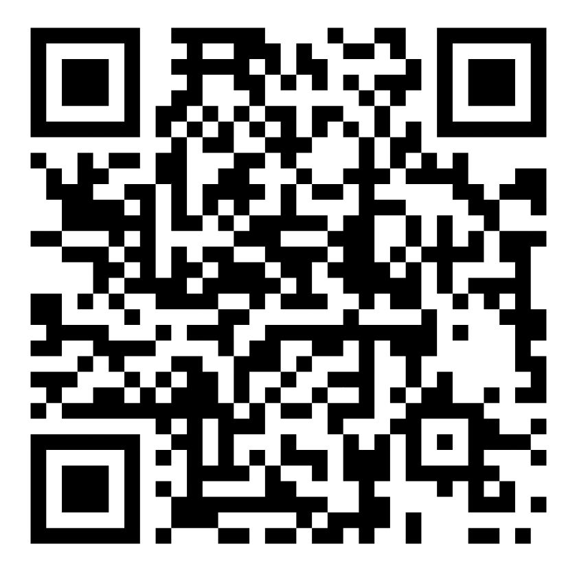

# Vdex

**Vdex is an app for people who film things for a living.**

It keeps your shoots, your crew, your camera gear, the places you film and your insurance in one place. On the day of a shoot it clocks your hours, prints your call sheet and tells you when the sun sets. Afterwards it makes the quote and the invoice.

It works on an iPhone, an Android phone, and a computer. There is no account to make and nothing to pay. Your information stays on your own phone or computer unless you choose to copy it somewhere.

## Start here (two minutes)

1. **Open Vdex.** It lives at this link, the same way a website does. Tap it, or type it into your phone's or computer's browser exactly as written:

   **https://thecrowbro.github.io/Logi-Video-Production-app-/**

   Or point your phone's camera at this square and tap the link that pops up:

   

2. **Put it on your home screen** so it works like a normal app, even with no signal:
   - **iPhone:** open the address in Safari, tap the **Share** button (the square with an arrow), then **Add to Home Screen**.
   - **Android:** tap **Install** at the top of the page.
   - **Computer:** tap **Install** at the top of the page. Or download the installer for Windows, Mac or Linux from the Releases page and double-click it.
3. **Tap ? at the top of any page.** It walks you through that page, box by box. You can do this as often as you like.

That's it. You're in.

## What the cards are

The spinning drum at the top is called the Rolodex. Swipe it, or tap the little arrows, to move between the cards:

| Card | What it's for |
|---|---|
| 📅 **Bookings** | Your calendar of shoots. Tap a day, then a shoot, to see everything about it. |
| 👥 **Crew** | The people you work with and how to reach them. |
| 🎥 **Equipment** | Everything you own, with serial numbers. Make kits for the shoots you do often. |
| 📍 **Venues** | The places you film: rules, parking, a map. |
| 🛡 **Insurance** | Your policies and when they run out. |
| 🪪 **Me** | Your own details, with a QR code that hands your contact card to anyone who scans it. |
| ☀️ **Field** | Sunrise and sunset, a white balance reader, a noise meter, a range finder. |
| 🎬 **TC Notes** | Shoot notes that are stamped with the camera's timecode. |
| ⚙️ **Settings** | Everything else, including your templates, backups and the lock. |

## Your first shoot

1. **Bookings → + New.** Type the job, the client, the date and the address. Tick the crew and the kit you're taking.
2. **On the day,** a bar appears under the Rolodex. Tap **Start work** when you begin and **Stop work** when you finish. Tap **Break** for lunch.
3. **Call sheet.** Open the booking and tap **Call sheet**. It's already filled in from the booking. Tap **Edit sheet** to add the schedule, then **Email crew** or **Print**.
4. **Afterwards,** open the booking's **Money** block to make the quote or the invoice. Vdex suggests the lines from the shoot.

Everything can be changed later. Nothing is ever lost by tapping the wrong thing: every screen has a back button.

## Keep your things safe

- **Set a PIN** in Settings → Security. Then Vdex locks when you put the phone down, and you can open it with your fingerprint or face. While it's locked, your information is scrambled so no one else can read it.
- **Link a cloud storage** with the ☁ button at the top: Dropbox, Google Drive or OneDrive. Your phone and your computer then share the same information, and Vdex keeps a daily backup copy there by itself.
- **Save a backup now and then:** Settings → Backups & data → **Export backup**. Keep the file somewhere safe. If your phone is lost, install Vdex on the new one and import the file.

## Need help?

- **Tap ?** at the top of any page, or inside any pop-up panel, for a walkthrough of what you're looking at.
- **Settings → About → Take the tour** shows you around the whole app again.
- **[The complete guide](docs/full-guide.md)** explains every button, separately for iPhone, Android and computers, with answers to common questions.

### If something isn't working

- **The camera, microphone or location won't start.** Your phone asked for permission once and you said no. Open your phone's Settings, find Vdex or your browser, and allow it.
- **My shoots aren't on my other device.** Link the same cloud storage on both devices with the ☁ button, or export a backup on one and import it on the other.
- **I forgot my PIN.** It can't be recovered. Tap **Forgot PIN?** on the lock screen, erase this device, then link your storage or import a backup and everything comes back.
- **Something looks out of date.** Close Vdex fully and open it again. New versions arrive by themselves; a bar at the bottom offers to reload when one has.
- **The link says “404” or “not found”.** The website hasn't been switched on yet. The person who looks after the tech can do that in a minute: see [For developers](docs/developers.md).

## For the person who looks after the tech

- [Connecting Dropbox, Google, Microsoft or your own server](docs/connections.md): one-time setup, needed only for those links.
- [For developers](docs/developers.md): running Vdex yourself, the tests, making the installers, signing, releasing updates, and how it is built.
- [Security](SECURITY.md): what protects your data and what doesn't.
