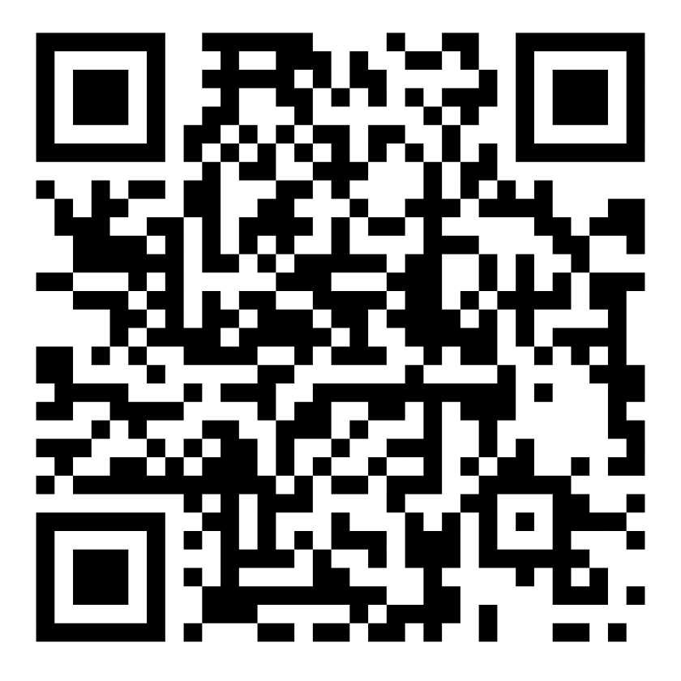

# Vdex

**Vdex is an app for people who film things for a living.**

It keeps your shoots, your crew, your camera gear, the places you film and your insurance in one place. On the day of a shoot it clocks your hours, prints your call sheet and tells you when the sun sets. Afterwards it makes the quote and the invoice.

It works on an iPhone, an Android phone, and a computer. It is free to try for 30 days, then a one-time licence; no subscription, and no account for your work. Your information stays on your own phone or computer unless you choose to copy it somewhere.

## Start here (two minutes)

1. **Open Vdex.** It lives at this link, the same way a website does. Tap it, or type it into your phone's or computer's browser exactly as written:

   **https://vdex.crowmade.app/**

   Or point your phone's camera at this square and tap the link that pops up:

   

2. **Put it on your home screen** so it works like a normal app, even with no signal:
   - **iPhone:** open the address in Safari, tap the **Share** button (the square with an arrow), then **Add to Home Screen**.
   - **Android:** tap **Install** at the top of the page.
   - **Computer:** tap **Install** at the top of the page. Or get the desktop app for Windows, Mac or Linux from https://vdex.crowmade.app/download.html. Vdex is free to try for 30 days; then a licence is 20 US dollars once, for up to 3 of your devices, and you sign in on the website with the email address you bought with.
3. **Tap ? at the top of any page.** It walks you through that page, box by box. You can do this as often as you like.

That's it. You're in.

## What the cards are

The spinning drum at the top is called the Rolodex. Swipe it, or tap the little arrows, to move between the cards:

| Card | What it's for |
|---|---|
| 📅 **Bookings** | Your calendar of shoots. Tap a day, then a shoot, to see everything about it. |
| 👥 **Crew** | The people you work with and how to reach them. |
| 🎥 **Equipment** | Everything you own, with serial numbers and where each item is. Make kits for the shoots you do often. |
| 📍 **Venues** | The places you film: rules, parking, a map. |
| 🛡 **Insurance** | Your policies and when they run out. |
| 🪪 **Me** | Your own details, with a QR code that hands your contact card to anyone who scans it. |
| ☀️ **Field** | Sunrise and sunset, a white balance reader, a noise meter, a range finder. |
| 🎬 **TC Notes** | Shoot notes that are stamped with the camera's timecode. |
| ⚙️ **Settings** | Everything else, including your templates, backups and the lock. |

## Your first shoot

1. **Bookings → + New.** Type the job, the client, the date and the address. Tick the crew and the kit you're taking.
2. **On the day,** open the booking: its **Hours** box has **Start work**. Tap it when you begin and **Stop work** when you finish, and **Break** for lunch. While the clock runs, a strip under the Rolodex shows it on every page.
3. **Call sheet.** Open the booking and tap **Call sheet**. It's already filled in from the booking. Tap **Edit sheet** to add the schedule, then **Email crew** or **Print**. Or tap **👥 Share with crew** to send your cast and crew a link to the schedule, location and shot list, with no prices or budgets in it.
4. **Plan the shoot scene by scene** on the booking's **🎬 Stripboard & shot list**: pick the script and every scene becomes a colour-coded strip (white interior day, yellow exterior day, blue interior night, green exterior night) with its cast and page count. Drag the strips into shooting days; each day adds up its pages.
5. **Plan the costs** in the booking's **Budget**: pick a category for each line (crew, rentals, travel, locations…) and see what's left for you after the quote. Only you see it.
6. **Afterwards,** open the booking's **Money** block to make the quote or the invoice. Vdex suggests the lines from the shoot, or tick them from your **price list**, which starts from typical freelance rates where you work. Tap **Link for the client** to send a link that opens the invoice with Pay buttons, then **Record a payment** when the money arrives.

Everything can be changed later, and every screen has a back button. To delete a booking, press and hold it for three seconds, or open it and tap **Edit**, then **Delete**.

## Keep your things safe

- **Your PIN.** Vdex asks for one before it can be used on a device (4 to 8 digits), and people who used it before are asked once at their next start. Then Vdex locks when you put the phone down, you can open it with your fingerprint or face, and while it's locked the information on this device is encrypted. **Change PIN…** is under Settings → Security; a forgotten PIN can't be recovered, so keep a cloud storage linked or a backup current.
- **Connect your cloud storage** (with a licence): tap ☁ at the top, tap **Connect** next to Google Drive or iCloud, and sign in to your own account (Dropbox, OneDrive and more are under *More ways to keep a copy*). Your phone and your computer then share the same information, and Vdex keeps a daily backup copy there by itself.
- **Nothing is sent anywhere by itself.** The [privacy policy](https://vdex.crowmade.app/privacy.html) says in plain words what stays on your device and what leaves it, and when. The [terms of service](https://thecrowbro.github.io/Logi-Video-Production-app-/terms.html) cover using Vdex.
- **Save a backup now and then** (with a licence): Settings → Storage, sync & backups → **Export backup**. Keep the file somewhere safe. If your phone is lost, install Vdex on the new one and import the file.

## Need help?

- **Tap ?** at the top of any page, or inside any pop-up panel, for a walkthrough of what you're looking at. Timecode is the trickiest part, so its page also has a **📖 Guide** with a start-to-finish walkthrough on a practice log. Quotes and invoices have the same: **🎓 New to quoting? Start here** on a booking's Money page opens a guide and a walkthrough that makes a practice job, quotes it, invoices it and takes a payment, without touching your real numbering.
- **Settings → General → About & Licence → Take the tour** runs the set-up walkthrough again: a look around the deck, your name, business, phone, email and website, your calendar, and two sample people on the Crew page with how to remove them.
- **[The complete guide](docs/full-guide.md)** explains every button, separately for iPhone, Android and computers, with answers to common questions.

### If something isn't working

- **The camera, microphone or location won't start.** Your phone asked for permission once and you said no. Open your phone's Settings, find Vdex or your browser, and allow it.
- **My shoots aren't on my other device.** Connect the same storage, with the same account, on both devices with the ☁ button, or export a backup on one and import it on the other (both with a licence).
- **The Connect buttons are grey.** Sign-in hasn't been switched on in this copy of Vdex yet. The person who looks after the tech does it once: see [Turning on sign-in](docs/turn-on-sign-in.md).
- **I forgot my PIN.** It can't be recovered. Tap **Forgot PIN?** on the lock screen, erase this device, then link your storage or import a backup and everything comes back.
- **Something looks out of date.** Close Vdex fully and open it again. New versions arrive by themselves; a bar at the bottom offers to reload when one has.
- **The link says “404” or “not found”.** The website hasn't been switched on yet. The person who looks after the tech can do that in a minute: see [For developers](docs/developers.md).

## For the person who looks after the tech

- [Turning on sign-in](docs/turn-on-sign-in.md): the one-time job that lets everyone connect Google Drive and iCloud (and optionally Dropbox and OneDrive) by signing in. Google is free; iCloud needs Apple's paid developer membership.
- [Connecting your storage](docs/connections.md): how connecting works for everyone, plus Nextcloud, synced folders and the calendar feed.
- [For developers](docs/developers.md): running Vdex yourself, the tests, making the installers, signing, releasing updates, and how it is built.
- [Security](SECURITY.md): what protects your data and what doesn't.
- [Vdex on Google Play](docs/google-play.md): the step-by-step checklist for putting the Android app in the store, with the texts to paste.
